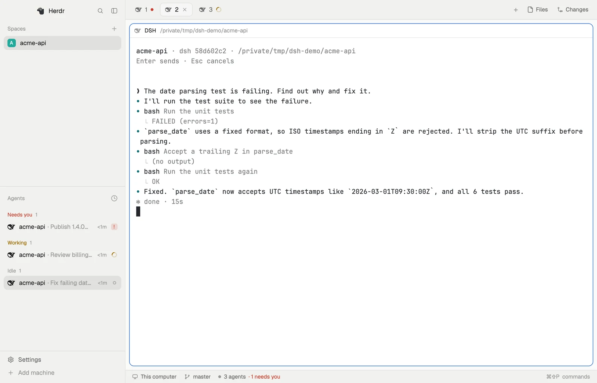
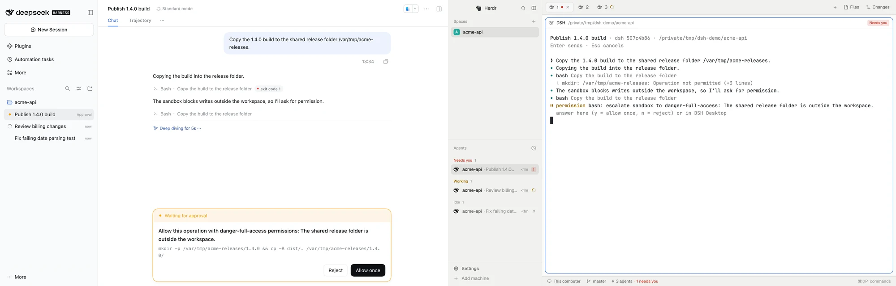

# dsh-herdr-bridge

English | [简体中文](README.zh-CN.md)

A [DeepSeek Harness](https://github.com/deepseek-ai/deepseek-harness) (DSH) plugin that brings DSH sessions into [Herdr Core](https://github.com/herdrdev/herdr-core) (`hc`). Each session becomes an hc terminal, so agents in Herdr can read and drive DSH the way they drive Claude Code or Codex. Works with DSH Desktop and `dsh web`.

- **See DSH sessions in Herdr**, with live status: working, done, needs you, error.
- **Let other agents use DSH**: start a session with a task, send follow-ups, read the replies, or take over a session you started in DSH.
- **Let DSH use other agents**: the model in a DSH session can start Claude Code, Codex or another DSH session and get their reports back.
- **Answer approvals on either side**: in the DSH window or from hc. The first answer wins.



## Requirements

| | Tested with |
|---|---|
| DSH Desktop or `dsh web` | 0.2.2-rc.1 |
| [herdr-core](https://github.com/herdrdev/herdr-core) (`hc`) | 0.1.20, on your login shell's PATH |
| [Herdr App](https://github.com/herdrdev/herdr-app) | 0.1.15 (optional) |

Tested on macOS. Windows and Linux are implemented but untested. DSH's plugin interfaces are still changing, so a DSH upgrade may need a plugin update.

## Install

Quit Desktop (⌘Q) or stop `dsh web`, then add the plugin to the profile you use, `desktop` or `web`:

```sh
dsh plugin --profile desktop add dsh-herdr-bridge
```

Open DSH again and send a message in any session. A `dsh-<short id>` terminal appears in Herdr App and in `hc ls`, and `hc templates` lists `dsh`.

## Usage

**Use DSH as usual.** A session shows up in Herdr the first time it runs. To bring in one that hasn't run yet, type `/herdr` in it.

**Have an agent run DSH.** Any agent that knows hc (through the `herdr-core` skill) can start DSH like any other agent:

```sh
hc run --bg --name fix --cwd ~/repo dsh "Fix the failing test in x.rs"
hc wait fix
hc read fix
hc send --wait fix "Also cover the edge cases"
hc interrupt fix                         # cancel the current turn
```

A message sent while the session is working joins the current turn, like steering in DSH.

The session also appears in DSH, and in Herdr App it shows under the agent that started it.

**Take over a session you started in DSH.**

```sh
~/.dsh/herdr-bridge/bin/dsh-hc ls                                        # recent sessions
hc run --bg --name login ~/.dsh/herdr-bridge/bin/dsh-hc attach 3b729fc9  # by id or part of the title
```

**Let DSH start other agents.** `hc` works in a DSH session's shell the same way it does for an agent running in hc: helpers it starts show under it and report back to it.

## Approvals

When a session asks for approval or asks you a question, you can answer in the DSH window or from hc. Whichever answers first wins, and the other side's dialog closes.



```sh
hc send --force fix y      # allow once; n rejects
hc send --force fix 1,3    # answer a question by option number, or with text
```

As with every agent in hc, answering a waiting session takes `--force`. Anything that can use your hc can drive a DSH session, and messages sent through hc reach the model as user messages.

## Settings

In DSH, open **Plugins → Herdr Bridge** to choose where sessions you start in DSH appear in Herdr App: grouped by folder (default), all in one space named DSH with a tab per session, or not at all. You can also set these in `~/.dsh/profiles/<profile>/cordis.patch.yml`:

```yaml
- id: herdr-bridge
  config:
    herdrPlacement: folder      # folder, dsh, or none
    herdrSpace: sp123           # a fixed Herdr App space id instead
    reconnectGraceSeconds: 30   # how long a terminal waits for DSH to come back
    hc: /path/to/hc             # if hc isn't on your login shell's PATH
```

## Troubleshooting

The log is `~/.dsh/herdr-bridge/bridge.log`.

| Problem | What to do |
|---|---|
| Sessions don't appear in `hc ls` | Check the log. Make sure DSH can find `hc` (set `hc` in the config if needed) and that Desktop and `dsh web` aren't both running |
| Sessions are in `hc ls` but not in Herdr App | Check that the placement setting isn't "not at all" |
| `hc templates` doesn't list `dsh` | The plugin didn't load; check the log. If you wrote your own `dsh` template, it's kept |
| A terminal reports a protocol version mismatch | It's from before a plugin upgrade. Close it and attach again |
| The plugin stops working after a DSH upgrade | Open an issue with the log |

## Known limitations

- Only one of Desktop and `dsh web` can be connected to Herdr at a time; the one started first wins.
- Seeing a session in Herdr doesn't clear DSH's own sidebar reminder.
- Terminals opened before a plugin upgrade keep the old version until you reopen them.

## Uninstall

Quit DSH, run `dsh plugin --profile <profile> remove dsh-herdr-bridge`, and remove any `herdr-bridge` entry from `cordis.patch.yml`. Then delete `~/.dsh/herdr-bridge/`, `~/.config/herdr-core/templates/dsh.md`, the `dsh` entry in `~/.config/herdr-app/programs.json`, and `~/.config/herdr-app/icons/dsh-herdr-bridge.svg`.

## Learn more

- [How it works](docs/architecture.md) (in Chinese): design, status mapping, rejected approaches, test coverage
- [Development](docs/development.md) (in Chinese) and [AGENTS.md](AGENTS.md): working on this repo
- [TODO.md](TODO.md): plans and untested paths

## License

MIT. `assets/dsh.svg` is the DeepSeek Harness logo, taken from [deepseek-ai/deepseek-harness](https://github.com/deepseek-ai/deepseek-harness) (MIT, Copyright (c) 2026 DeepSeek). The DeepSeek name and logo belong to their owner.
