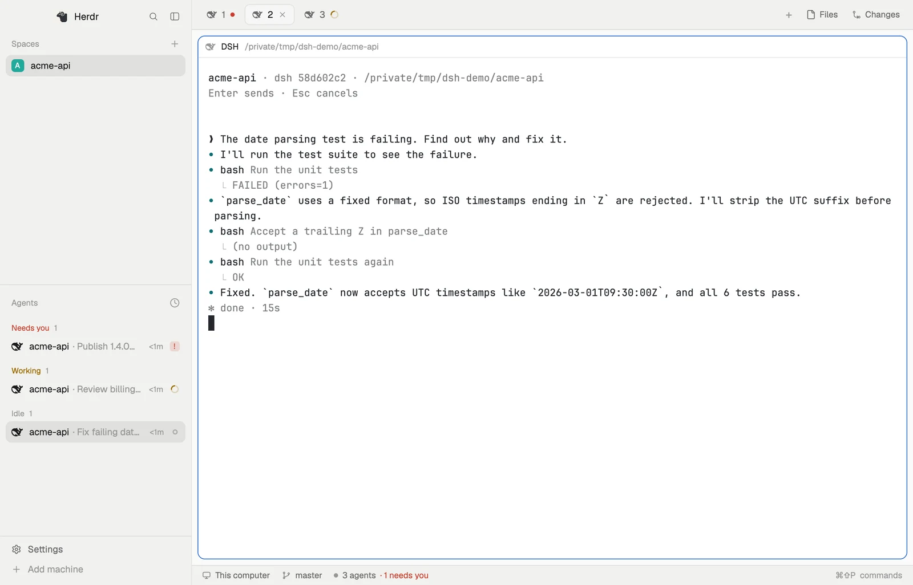
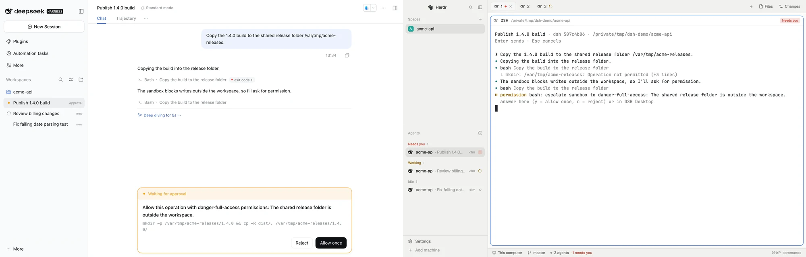

# dsh-herdr-bridge

[English](README.md) | 简体中文

一个 [DeepSeek Harness](https://github.com/deepseek-ai/deepseek-harness)（DSH）插件，把 DSH 的会话接进 [Herdr Core](https://github.com/herdrdev/herdr-core)（`hc`）：每个会话变成一个 hc 终端，Herdr 里的其他 Agent 可以像操控 Claude Code 一样读取和操控它。适用于 DSH Desktop 和 DSH Web（`dsh web`）。

装好以后：

- **在 Herdr 里看到 DSH 会话**：会话一开始运行，[Herdr App](https://github.com/herdrdev/herdr-app) 里就出现一个 `dsh-<短 id>` 终端，状态在 `working / done / blocked / error` 之间跟着变。
- **从 Herdr 操控 DSH**：Herdr Agent 用 `hc run / send / wait / read / interrupt` 新建会话、接管已有会话、发消息、取消回合。
- **让 DSH 调度其他 Agent**：DSH 里的模型可以用 `hc` 启动 helper（比如 Claude Code），helper 的回报会送回这个 DSH 会话。
- **审批两边都能答**：会话等待审批或提问时，在 DSH 界面或 hc 里回答都行，先答者生效，另一边的对话框会撤回。

插件运行在 DSH 自己的进程里，不需要第二份 DSH，也不修改 DSH、Herdr 的任何源码。

## 效果



Herdr App 里的三个 DSH 会话，状态各不相同。右侧是其中一个会话在 hc 终端里的样子：提示、回复、带描述的工具调用和回合用时，格式和原生 TUI Agent 一样。

## 要求

| | 开发时使用的版本 | 说明 |
|---|---|---|
| DSH（Desktop 或 `dsh web`） | 0.2.2-rc.1 | 插件依赖的 DSH 接口仍在变化，升级 DSH 后可能需要更新插件。`dsh headless` 不支持，`dsh tui` 没有测试过 |
| herdr-core（`hc`） | 0.1.18 | `hc` 需要在登录 shell 的 PATH 上，或在配置里指定 |
| herdr-app | 0.1.13 | 可选 |

Desktop 和 `dsh web` 同一时间只能有一个接入 Herdr（见已知限制）。

平台：只在 macOS 上验证过。Windows / Linux 的代码路径已写好，但没有测试过。暂无最低版本要求，只保证上表这一组合。

## 安装

1. 装进你使用的 DSH profile。Desktop 用 `desktop`，要先完全退出 Desktop（⌘Q）；Web 用 `web`，要先停掉 `dsh web`：
   ```sh
   dsh plugin --profile desktop add dsh-herdr-bridge   # 或 --profile web
   ```
2. 重新打开 Desktop 或启动 `dsh web`。插件加载时会生成命令 `~/.dsh/herdr-bridge/bin/dsh-hc`。
3. 把它加进 PATH（下文的示例都假设已经加好），然后执行 `install-template`。它安装 hc template，让 `hc run dsh "任务"` 可用；装了 Herdr App 的话，还会在 Herdr App 的程序表里加上 DSH 的名字和图标，DSH 会话在 Agent 列表里就不再是通用图标：
   ```sh
   fish_add_path ~/.dsh/herdr-bridge/bin                # fish；zsh/bash 在 rc 文件里加 export PATH="$HOME/.dsh/herdr-bridge/bin:$PATH"
   dsh-hc install-template                              # 写入 hc template；有 Herdr App 时再写入它的 programs.json 和图标
   ```

**确认安装成功**：

```sh
dsh-hc ls          # 列出 DSH 里最近的会话（还没有会话时显示 no DSH sessions in that period）
```

然后在 DSH 里随便发一条消息，`hc ls` 里应该出现 `dsh-<短 id>` 终端。

**卸载**：退出 Desktop 或停掉 `dsh web`，执行 `dsh plugin --profile <profile> remove dsh-herdr-bridge`；如果你在 `~/.dsh/profiles/<profile>/cordis.patch.yml` 里加过 `herdr-bridge` 配置，一并删掉。再删除 `~/.config/herdr-core/templates/dsh.md`、`~/.dsh/herdr-bridge/`，以及 `~/.config/herdr-app/programs.json` 里的 `dsh` 条目和 `~/.config/herdr-app/icons/dsh-herdr-bridge.svg`。已经开着的 `dsh-*` 终端会在宽限期后自行退出。

## 快速上手

**1. 在 DSH 里正常使用。** 会话第一次运行时，插件为它开一个 `dsh-<短 id>` 终端，终端标题就是会话标题（随改名同步），另带标签 `dsh.session=<会话 id>` 和 `dsh.title=<会话标题>`。还没运行过的会话，在 DSH 里对它输入 `/herdr`，它就会出现在 Herdr 里，命令会显示它的 hc 地址。会话关闭时，终端随之结束。

**2. 从 Herdr 新建一个 DSH 会话。** 下面的 `/repo`、`fix` 都是示例：

```sh
hc run --bg --name fix --cwd /repo dsh "修复 x.rs 里失败的测试"
hc wait fix               # 等这一回合结束
hc read fix               # 读回复
hc send --wait fix "继续，把边界情况也测了"
```

新会话的目录如果正好是 DSH 里已有的 Workspace，就加入它；是某个 Workspace 的子目录，就建成“未分组”会话；其他目录会自动添加为新的 Workspace。

**3. 接管一个已有会话。**

```sh
dsh-hc ls --days 7                                  # 会话 id、标题、目录、是否已在 hc 里
hc run --bg --name login dsh-hc attach 3b729fc9     # 用 id、id 前缀或标题片段
hc read login                                       # 先看到之前的对话，再看到新的
```

如果这个会话已经有自动映射的 `dsh-<短 id>` 终端，那个终端会退出，由接管的终端代替。

**4. 需要时取消。** `hc interrupt fix` 取消当前回合，相当于在 DSH 里点停止。

## 审批、提问与信任边界

会话等待审批或提问时，DSH 界面照常弹出对话框，hc 终端里也显示同一个问题，状态为 `blocked`。



在 hc 侧回答必须加 `--force`：

```sh
hc send --force fix y      # 批准一次；n 为拒绝
hc send --force fix 1,3    # 提问：选项序号（多选用逗号），也可以写自由文本，或 - 跳过
```

这和 hc 对待其他 Agent 的规则一致：hc 拒绝向 blocked 的程序普通 `send`，`--force` 是唯一的闸门。插件本身从不自动回答，什么时候可以用 `--force`，由驱动它的 Agent 的指令决定（见 `hc --skill`）。

需要知道的边界：

- **谁能操控会话**：能使用你的 hc 的进程，都能读取和操控已映射的 DSH 会话，和 hc 里的其他终端一样。插件的控制 socket 在 `~/.dsh/herdr-bridge/control.sock`，只在本机。
- **权限不放大**：hc 发来的消息走 DSH 正常的 prompt 流程，会话原有的沙箱和审批规则照常生效。
- **来自 hc 的输入会成为用户消息**：`hc send` 的文本，以及 helper 的回报和 hc 通知（完成、blocked、退出），都会作为下一条用户消息进入 DSH 会话并唤醒它。hc 发出的消息带有 `<hc …>` 标记，模型能看出来源，但它们和你亲手输入的消息处在同一个位置。

## DSH 调度其他 Agent

插件给已映射的会话注入 `DSH_HC_TERMINAL`（会话自己的 hc 地址），并注册一个 skill `herdr-bridge`，告诉模型这样启动 helper：

```sh
hc run --bg --parent "$DSH_HC_TERMINAL" --name helper --cwd /repo claude "…完成后用 hc send $DSH_HC_TERMINAL 汇报"
```

通用的 hc 用法来自 `~/.agents/skills/herdr-core`，DSH 会自动发现这个目录。

## 配置

在 DSH 里打开 **插件 → dsh-herdr-bridge → 配置**，就能选择会话在 Herdr App 里放在哪里，改完不用重启就生效。所有设置也都可以写在 `~/.dsh/profiles/<profile>/cordis.patch.yml` 的 `herdr-bridge` 条目下，全部可选：

```yaml
- id: herdr-bridge
  config:
    herdrPlacement: folder      # 在 DSH 里发起的会话放进 Herdr App 的哪个 space：folder（默认）、dsh 或 none
    herdrSpace: sp123           # 固定的 Herdr App space id；填了就以它为准
    reconnectGraceSeconds: 30   # 插件断开后，终端等待重连的秒数，超时退出（默认 30）
    hc: /path/to/hc             # hc 可执行文件，默认是 PATH 上的 hc
```

Herdr App 只显示放进它某个 space 的 hc 终端。`folder`：在 DSH 里发起的会话，加入 Herdr App 里已经有终端在同一文件夹的那个 space；没有的话，Herdr App 为这个文件夹新开一个 space。`dsh`：所有会话共用一个 space，名字取第一个会话的文件夹，你在 Herdr App 里改名后就固定下来。`none`：不放进 Herdr App，但 `hc ls` 和其他客户端照样能看到。Herdr Agent 用 `hc run dsh` 发起的会话，无论哪种设置，都显示在那个 Agent 下面。

## 故障排查

先看日志 `~/.dsh/herdr-bridge/bridge.log`。

| 现象 | 检查 |
|---|---|
| 在 DSH 里发起的会话 `hc ls` 里有，但 Herdr App 里没有 | 检查 `herdrPlacement` 不是 `none`。Herdr App 只显示放进 space 的终端；旧版插件开出的终端会在重连时补上 |
| DSH 里在用的会话，`hc ls` 里没有 | 日志里有没有插件加载和开终端失败的记录；DSH 进程能否找到 `hc`（Desktop 用登录 shell 的 PATH，`dsh web` 用启动它的 shell 的 PATH；找不到就在配置里设 `hc`）；是否同时开着 Desktop 和 `dsh web`（见已知限制） |
| `dsh-hc: command not found` | PATH 没加好；直接用 `~/.dsh/herdr-bridge/bin/dsh-hc`。这个文件不存在说明插件没加载 |
| `hc run dsh …` 提示找不到 template | 执行 `dsh-hc install-template` |
| Herdr App 里 DSH 会话显示通用的机器人图标 | 先启动过一次 Herdr App，再执行 `dsh-hc install-template`；它会提示 `programs.json` 是否写入或保留了已有的 `dsh` 条目 |
| 终端显示“断开 → 重新连接” | 插件重载了（比如你在 DSH 里改了设置），正常现象，地址不变 |
| `dsh-*` 终端突然退出 | DSH 退出或插件超过 `reconnectGraceSeconds` 没回来；重开 DSH 后，会话下次运行时会重新映射 |
| 终端报协议版本不符 | 插件升级后旧终端还在跑旧代理；关掉终端重新 `attach` |
| 升级 DSH 后插件不工作 | DSH 接口有变化，暂时降级 DSH 或等插件更新，并把日志附在 issue 里 |

## 已知限制

- **Desktop 和 `dsh web` 不能同时接入**：两者共用 `~/.dsh/herdr-bridge/`，只有先启动的那个能正常接入 Herdr。
- **在 DSH 里看过的回合，Herdr 仍会标成没看过**：Herdr 不知道 DSH 界面也是一个观看者。
- **每个映射出去的会话有一个代理进程**，实际物理内存约 13–14 MB。
- **插件升级后，已开着的终端仍运行旧代理**，直到重开。
- **审批的“另一边撤回”依赖 DSH 的内部实现**：DSH 改动后可能失效，表现是 DSH 界面的对话框不消失，不会导致错误批准。

计划和未验证的路径见 [TODO.md](TODO.md)。

## 工作原理

每个 hc 终端里跑一个很薄的代理 `dsh-hc`（用运行 DSH 的同一个 Node，Desktop 上就是它自带的那个），通过本机 socket 连到 DSH 进程里的插件。插件把 DSH 事件渲染成终端文本和 OSC 7501 状态，把终端输入转成 prompt、取消或审批回答。插件重载时代理会重连，hc 地址不变。

架构、状态映射、竞争应答的实现、被否决的方案和测试覆盖，见 [docs/architecture.md](docs/architecture.md)。

## 开发

从源码安装、开发回路和隔离测试环境见 [docs/development.md](docs/development.md)，Agent 的工作约定见 [AGENTS.md](AGENTS.md)。简述：

```sh
scripts/dev.sh up          # 隔离环境：模拟 LLM + 隔离 hc core + 隔离 dsh web（Desktop 替身）
scripts/dev.sh reload      # 热重载插件
scripts/e2e.sh             # 37 项 hc 侧回归
scripts/e2e-ui.sh          # 14 项 UI 侧回归（ego-browser）
scripts/dev.sh down
scripts/desktop.sh reload  # 把改动热重载进真实 Desktop（只改 cordis.patch.yml 里 herdr-bridge 这一项，首次会备份）
```

## 许可

MIT。`assets/dsh.svg` 是 DeepSeek Harness 的标志，取自 [deepseek-ai/deepseek-harness](https://github.com/deepseek-ai/deepseek-harness)（MIT，Copyright (c) 2026 DeepSeek）；DeepSeek 的名称和标志归其所有者。
